```mermaid
flowchart LR
    classDef input fill:#e8f0fe,stroke:#4a6fa5,color:#17324d
    classDef decision fill:#fff4d6,stroke:#b7791f,color:#4a3410
    classDef action fill:#dff7e3,stroke:#2f855a,color:#1f3b2d
    classDef result fill:#f3e8ff,stroke:#7c3aed,color:#35143f

    subgraph AP["Autopilot Object"]
        direction TB
        ap_start([Device serial loaded]):::input
        ap_csv{Serial in CSV?}:::decision
        ap_remove[AutopilotWhatIf = Remove]:::action
        ap_retain[AutopilotWhatIf = Retain]:::result
    end

    subgraph EID_AP["Entra Object (from AP)"]
        direction TB
        eid_ap_found{Entra device found?}:::decision
        eid_ap_delete{Approx. last sign-in <= deletion threshold?}:::decision
        eid_ap_disable{Approx. last sign-in <= disable threshold?}:::decision
        eid_ap_remove[Entra action = Remove]:::action
        eid_ap_disable_action[Entra action = Disable]:::action
        eid_ap_retain[Entra action = Retain]:::result
    end

    subgraph INTUNE["Intune Object"]
        direction TB
        intune_found{Intune device found?}:::decision
        intune_delete{Last sync <= deletion threshold?}:::decision
        intune_disable{Last sync <= disable threshold?}:::decision
        intune_remove[Intune action = Remove]:::action
        intune_retire[Intune action = Retire]:::action
        intune_retain[Intune action = Retain]:::result
        intune_not_found[Intune action = Not Found]:::result
    end

    subgraph EID_INTUNE["Entra Object (from Intune)"]
        direction TB
        eid_intune_link{Intune linked to same Entra object?}:::decision
        eid_intune_delete{Approx. last sign-in <= deletion threshold?}:::decision
        eid_intune_disable{Approx. last sign-in <= disable threshold?}:::decision
        eid_intune_remove[Entra action = Remove]:::action
        eid_intune_disable_action[Entra action = Disable]:::action
        eid_intune_retain[Entra action = Retain]:::result
        eid_intune_na[Entra action = Not Applicable]:::result
    end

    ap_start --> ap_csv
    ap_csv -- Yes --> ap_remove
    ap_csv -- No --> ap_retain
    ap_remove --> eid_ap_found
    ap_retain --> eid_ap_found

    eid_ap_found -- No --> eid_ap_retain
    eid_ap_found -- Yes --> eid_ap_delete
    eid_ap_delete -- Yes --> eid_ap_remove
    eid_ap_delete -- No --> eid_ap_disable
    eid_ap_disable -- Yes --> eid_ap_disable_action
    eid_ap_disable -- No --> eid_ap_retain

    ap_retain --> intune_found
    ap_remove --> intune_found
    eid_ap_retain --> intune_found
    eid_ap_disable_action --> intune_found
    eid_ap_remove --> intune_found

    intune_found -- No --> intune_not_found
    intune_found -- Yes --> intune_delete
    intune_delete -- Yes --> intune_remove
    intune_delete -- No --> intune_disable
    intune_disable -- Yes --> intune_retire
    intune_disable -- No --> intune_retain

    intune_found -- No --> eid_intune_na
    intune_found -- Yes --> eid_intune_link
    eid_intune_link -- No --> eid_intune_na
    eid_intune_link -- Yes --> eid_intune_delete
    eid_intune_delete -- Yes --> eid_intune_remove
    eid_intune_delete -- No --> eid_intune_disable
    eid_intune_disable -- Yes --> eid_intune_disable_action
    eid_intune_disable -- No --> eid_intune_retain

    ap_remove -. explicit cleanup candidate .-> ap_csv
    intune_remove -. delete or retire decision .-> eid_intune_link
    intune_retire -. retire path .-> eid_intune_link
```

# Broken Autopilot Device Cleanup Flow

<!-- markdownlint-disable MD033 -->

  <button id="mermaid-zoom-out" title="Zoom out">&minus;</button>
  100%
  <button id="mermaid-zoom-in" title="Zoom in">+</button>
  <button id="mermaid-zoom-reset" title="Reset zoom">Reset</button>

<!-- markdownlint-enable MD033 -->

The flow mirrors the script's current evaluation order:

- Autopilot uses the CSV flag when present.
- Entra from Autopilot uses the same deletion and disable thresholds as the other objects.
- Intune uses last sync thresholds to choose Remove, Retire, or Retain.
- Entra from Intune follows the same date thresholds when Intune is present, otherwise it stays Not Applicable.
