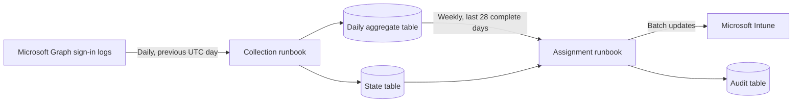

# Repair Primary User

This Azure Automation solution repairs Microsoft Intune primary-user assignments from successful Windows sign-ins. It replaces one memory-heavy runbook with two independently scheduled PowerShell 7.2 runbooks and compact Azure Table aggregates.

## Architecture



The daily collector reads the previous completed UTC day, counts successful `Windows Sign In` events by device and user, and stores only the count and latest sign-in timestamp. Raw audit events are not stored.

The weekly analyzer requires every expected daily partition to be marked `Complete`. It totals the previous 28 days, selects the user with the most sign-ins, and uses the latest successful sign-in as a deterministic tie-breaker. Devices without eligible sign-ins are unchanged.

## Azure resources

The deployment creates:

- One StorageV2 account with shared-key access disabled.
- `PrimaryUserDaily`, `PrimaryUserState`, and `PrimaryUserAudit` Azure Tables.
- One Azure Automation Account with a system-assigned managed identity.
- `Storage Table Data Contributor` assignments scoped to the three solution tables.
- Published PowerShell 7.2 daily and weekly runbooks with UTC schedules.

The managed identity requires these Microsoft Graph application permissions:

- `AuditLog.Read.All`
- `DeviceManagementManagedDevices.ReadWrite.All`

The deployment script can grant both permissions. The administrator running it needs permission to deploy Azure resources and role assignments, plus a Microsoft Entra role permitted to grant application permissions. Microsoft Entra audit-log licensing and retention must cover the configured analysis period.

## Deployment

Run the deployment from PowerShell 7.2 on an administration workstation or Azure Cloud Shell. Bicep must be available through Azure PowerShell, Azure CLI, or a `bicep` executable.

```powershell
pwsh.exe -NoProfile -File .\Deployment\Deploy-RepairPrimaryUser.ps1 `
    -SubscriptionId '<subscription-id>' `
    -TenantId '<tenant-id>' `
    -ResourceGroupName 'rg-repair-primary-user' `
    -Location 'westeurope' `
    -StorageAccountName '<globally-unique-storage-name>' `
    -InstallMissingModules
```

Defaults:

- Daily collection: `03:00` UTC.
- Weekly analysis: Sunday at `05:00` UTC.
- Analysis window: 28 completed UTC days.
- Daily aggregate retention: 35 days.
- Assignment mode: apply changes.

The weekly time must be at least one hour after the daily collection time. Override the defaults with `-CollectorStartTimeUtc`, `-AnalyzerStartTimeUtc`, and `-AnalyzerDayOfWeek`.

Use `-SkipGraphPermissionGrant` only when both Graph application permissions will be assigned to the Automation Account managed identity separately.

## Initial warm-up

The analyzer intentionally fails without making changes until all 28 required daily partitions exist. This protects assignments from incomplete evidence. After first deployment, allow 28 daily collections to complete before expecting the weekly run to apply changes.

For controlled testing, start the analyzer manually with a smaller `DaysToAnalyze` value after collecting those dates explicitly. Restore the scheduled value to 28 before production use.

## Table schema

`PrimaryUserDaily` stores one row per UTC date, device, and user:

- `PartitionKey`: collection date as `yyyyMMdd`.
- `RowKey`: `<device-guid>|<user-guid>`.
- `DeviceId`: Microsoft Entra device ID.
- `UserId`: Microsoft Entra user ID.
- `SignInCount`: successful sign-ins for that day.
- `LatestSignIn`: latest successful sign-in in UTC.

`PrimaryUserState` stores collection status, analysis locks, and run summaries. Collection rows use partition `Collection`; weekly summaries use `AnalysisRuns`.

`PrimaryUserAudit` stores one row per evaluated Intune device and weekly run. Its partition key is the unique run ID. Outcomes include `Unchanged`, `Preview`, `Updated`, and `Failed`.

## Daily collection

The scheduled collector processes the previous completed UTC date. To recollect a specific date after a failed or incorrect run:

```powershell
Start-AzAutomationRunbook `
    -ResourceGroupName 'rg-repair-primary-user' `
    -AutomationAccountName '<automation-account>' `
    -Name 'Collect-PrimaryUserSignInData' `
    -Parameters @{
        StorageAccountName = '<storage-account>'
        CollectionDate = '2026-09-01'
        ForceRecollect = $true
    }
```

Collection uses replacement semantics. An incomplete date partition is deleted and rebuilt, so restarting it does not double-count sign-ins. Completed dates are skipped unless `ForceRecollect` is supplied.

Partitions older than `RetentionDays` are removed after successful collection. Keep retention greater than the analysis window; 35 days provides seven days of recovery margin.

## Weekly analysis

Assignments are applied by default. Run a preview manually before enabling production changes or after changing policy:

```powershell
Start-AzAutomationRunbook `
    -ResourceGroupName 'rg-repair-primary-user' `
    -AutomationAccountName '<automation-account>' `
    -Name 'Repair-PrimaryUserAssignments' `
    -Parameters @{
        StorageAccountName = '<storage-account>'
        Preview = $true
    }
```

Preview recommendations are written to `PrimaryUserAudit` and no Intune assignment request is submitted. The scheduled run omits `Preview` and therefore applies changes.

The analyzer:

1. Acquires an Azure Table lock to prevent overlapping weekly runs.
2. Verifies all expected collection states.
3. Aggregates daily device/user counts.
4. Pages company-owned Windows Intune devices.
5. Skips unchanged devices.
6. Sends changed assignments in Microsoft Graph batches of at most 20.
7. Retries throttled and transient requests and records each outcome.

## Monitoring and recovery

- Check Azure Automation job output and errors for both runbooks.
- Inspect the `Collection` partition in `PrimaryUserState` for missing or non-`Complete` dates.
- Recollect a missing date with `CollectionDate` and `ForceRecollect`, then rerun the analyzer.
- Inspect `AnalysisRuns` in `PrimaryUserState` for weekly totals and terminal status.
- Inspect the matching run-ID partition in `PrimaryUserAudit` for device-level recommendations and failures.
- A stale analysis lock is replaced after 12 hours by default. Lower `StaleLockHours` only when a complete analysis is known to finish sooner.

The analyzer fails closed: missing daily data, Graph retrieval failures, or lock conflicts stop the run before new assignments are submitted. Individual batch failures are audited and do not hide successful updates from the same run.

## Cost and scale

Storage contains compact aggregates rather than raw audit events. Approximate daily row count is the number of distinct device/user combinations that signed in that day, not the number of sign-in events. Azure Automation and Microsoft Graph limits still vary by tenant size; review job memory, duration, throttling, and table growth before broad production rollout.

## Removal

Unregister and remove the two schedules, remove the two Automation runbooks, revoke the managed identity's two Graph app-role assignments, and delete the resource group if it contains only this solution. Deleting the resource group permanently removes aggregate and audit history.

## Change history

See [changelog.md](changelog.md).
